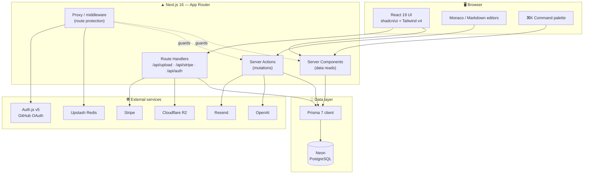
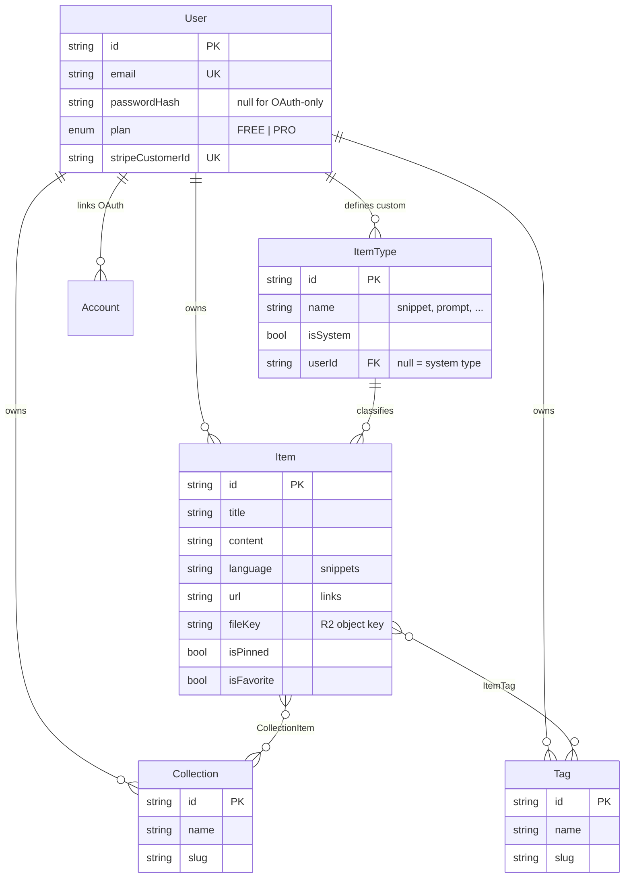
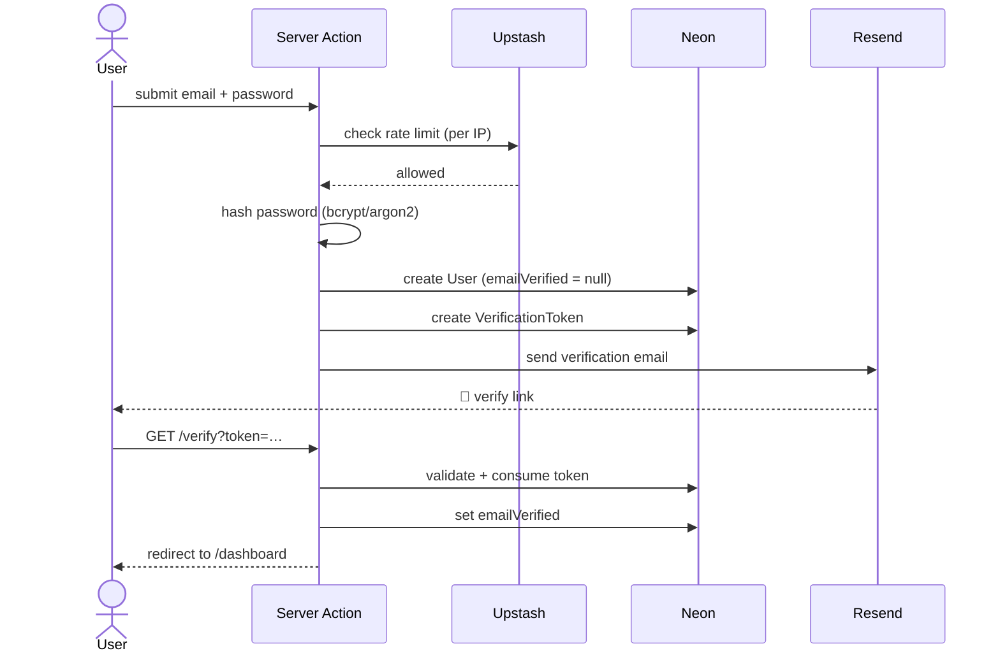
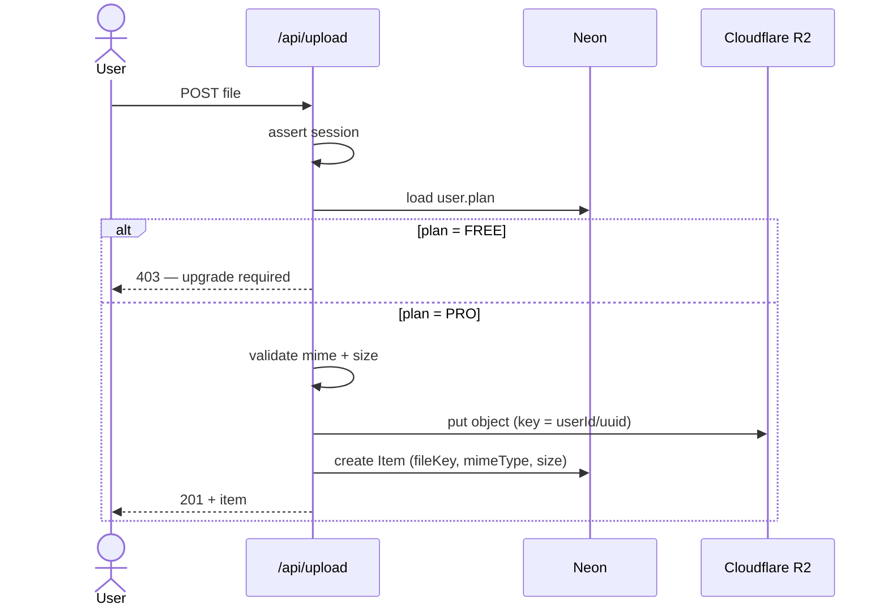
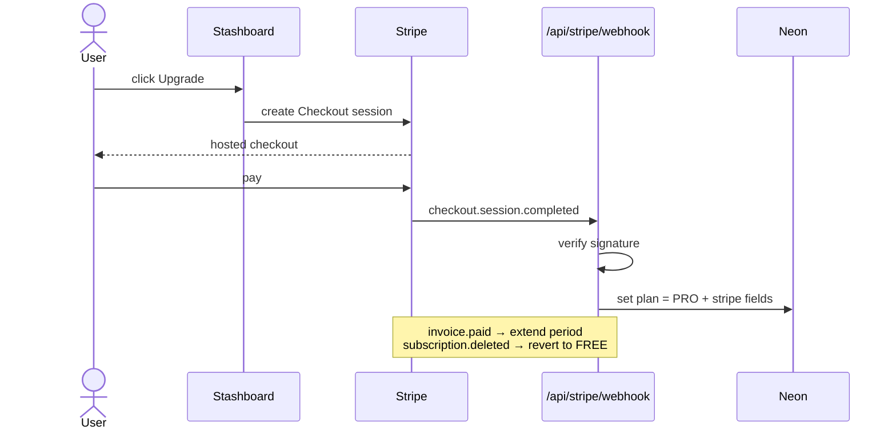

<p align="center">
  
</p>

<h1 align="center">Stashboard</h1>

<p align="center">
  <strong>A unified hub for developer knowledge &amp; resources</strong>
</p>

<p align="center">
  
  
  
  
  
  
  
</p>

> [!IMPORTANT]
> **This document describes the target state, not the current one.**
> The repository today is a cleaned-up `create-next-app` scaffold: a root layout and a single `/` route. No database, auth, payments, or tests exist yet. Every schema, route, and script below is a specification to build toward. See [Reality check](#-reality-check--review-notes) for the gap list.

---

## 📑 Contents

- [The problem](#-the-problem)
- [Features](#-features)
- [Plans](#-plans-free-vs-pro)
- [Tech stack](#-tech-stack)
- [Architecture](#-architecture)
- [Data model](#-data-model)
- [Key flows](#-key-flows)
- [Getting started](#-getting-started)
- [Environment variables](#-environment-variables)
- [Scripts](#-scripts)
- [Project structure](#-project-structure)
- [Reality check & review notes](#-reality-check--review-notes)
- [Open questions](#-open-questions)
- [Credits & license](#-credits--license)

---

## 🎯 The problem

Developers keep their essentials scattered across VS Code snippets, browser bookmarks, chat histories, shell history, and random folders. Nothing is searchable across those silos, and nothing survives a machine change cleanly.

Stashboard brings all of it into **one fast, searchable, AI-enhanced hub** — a single store for the code, prompts, commands, and links you reach for every day.

---

## ✨ Features

### Core

| | Feature |
|---|---|
| 📦 | Save code **snippets**, AI **prompts**, terminal **commands**, **notes**, and **links** |
| 📁 | Upload **files** and **images** <sub>`PRO`</sub> |
| 🗂️ | Organize items into **collections** (many-to-many — an item can live in several) |
| 📌 | **Pin**, **favorite**, and **tag** items for quick access |
| 🎨 | **Monaco** editor with syntax highlighting for 30+ languages |
| 📝 | **Markdown** editor with GitHub Flavored Markdown preview |
| ⌨️ | Global search / command palette (<kbd>Cmd</kbd>+<kbd>K</kbd>) |
| 🌗 | Dark mode by default, light mode optional |
| 🧩 | **Custom item types** beyond the seven system types |

### AI-powered <sub>`PRO`</sub>

| | Feature |
|---|---|
| 🏷️ | **Auto-tag suggestions** — infer tags from item content |
| ✍️ | **Description generator** — summarize an item in a sentence |
| 💡 | **Code explanation** — plain-English walkthrough of a snippet |
| 🎛️ | **Prompt optimizer** — rewrite a saved prompt for better results |

### Platform

| | Feature |
|---|---|
| 🔐 | Email/password and **GitHub OAuth** authentication |
| ✉️ | Email verification and password reset flows |
| 🛡️ | Rate limiting on auth endpoints |
| 💳 | **Stripe** subscriptions (Free / Pro) |
| ☁️ | File uploads via **Cloudflare R2** |
| 🔄 | Import/export — JSON (Free), ZIP with files (Pro) |
| 📄 | Pagination, sorting, and filtering |
| 📱 | Responsive across desktop, tablet, and mobile |

---

## 💎 Plans (Free vs Pro)

| Capability | Free | Pro |
|---|:---:|:---:|
| Snippets, prompts, commands, notes, links | ✅ | ✅ |
| Collections, tags, pinning, favorites | ✅ | ✅ |
| Monaco + Markdown editors | ✅ | ✅ |
| Command palette & search | ✅ | ✅ |
| File & image uploads | ❌ | ✅ |
| AI auto-tag, descriptions, explain, prompt optimizer | ❌ | ✅ |
| Custom item types | ❌ | ✅ |
| Export format | JSON | JSON + ZIP (with files) |
| Billing | — | Monthly / Yearly |

> [!WARNING]
> Tier limits must be enforced **server-side** in server actions and route handlers — never only by hiding UI. Treat `plan` as untrusted on the client.

---

## 🧱 Tech stack

| Category | Technology | |
| --- | --- | --- |
| Framework | [Next.js 16](https://nextjs.org) / [React 19](https://react.dev) | App Router, Server Actions, Turbopack |
| Language | [TypeScript 5](https://www.typescriptlang.org) | `strict: true` |
| Database | [Neon](https://neon.tech) PostgreSQL | Serverless Postgres |
| ORM | [Prisma 7](https://www.prisma.io) | Migrations + typed client |
| Auth | [NextAuth v5 / Auth.js](https://authjs.dev) | JWT session strategy |
| Styling | [Tailwind CSS v4](https://tailwindcss.com) + [shadcn/ui](https://ui.shadcn.com) | CSS-first config |
| Editors | [Monaco](https://microsoft.github.io/monaco-editor/) | Same engine as VS Code |
| AI | [OpenAI](https://platform.openai.com/docs) | Tagging, summaries, explain |
| Payments | [Stripe](https://stripe.com/docs) | Checkout + webhooks |
| File storage | [Cloudflare R2](https://developers.cloudflare.com/r2/) | S3-compatible |
| Rate limiting | [Upstash Redis](https://upstash.com) | Serverless Redis |
| Email | [Resend](https://resend.com) | Verification, resets |
| Testing | [Vitest](https://vitest.dev) | Not yet installed |

---

## 🏗️ Architecture



**Conventions worth fixing early:**

- **Reads in Server Components, writes in Server Actions.** Reserve route handlers for things that genuinely need an HTTP endpoint — file upload/download streams, Stripe webhooks, and Auth.js.
- **All Prisma access goes through `src/lib/db/`.** Server Actions should call query functions, not build queries inline. This keeps ownership checks (`where: { userId }`) in one auditable place.
- **Every query is scoped by `userId`.** This is a multi-tenant app on a single database; a missing `userId` filter is a data leak, not a bug.

---

## 🗄️ Data model

### Entity relationships



### Prisma schema

> [!NOTE]
> Prisma 7 moves configuration to `prisma.config.ts` and prefers the newer `prisma-client` generator over `prisma-client-js`. Confirm the generator block against the [Prisma 7 docs](https://www.prisma.io/docs) when you scaffold — the model syntax below is stable across versions, the generator block is the part that moved.

```prisma
generator client {
  provider = "prisma-client"
  output   = "../src/generated/prisma"
}

datasource db {
  provider = "postgresql"
  url      = env("DATABASE_URL")
}

// ─────────────────────────────  Auth  ─────────────────────────────

model User {
  id            String    @id @default(cuid())
  name          String?
  email         String    @unique
  emailVerified DateTime?
  image         String?
  passwordHash  String? // null for OAuth-only accounts

  plan                   Plan      @default(FREE)
  stripeCustomerId       String?   @unique
  stripeSubscriptionId   String?   @unique
  stripePriceId          String?
  stripeCurrentPeriodEnd DateTime?

  // Editor preferences (settings page)
  preferredTheme    String @default("dark")
  preferredFontSize Int    @default(14)

  accounts    Account[]
  items       Item[]
  collections Collection[]
  tags        Tag[]
  itemTypes   ItemType[] // custom types only

  createdAt DateTime @default(now())
  updatedAt DateTime @updatedAt
}

/// Auth.js OAuth account linking (GitHub).
/// No Session model: the JWT strategy keeps sessions off the database.
model Account {
  userId            String
  type              String
  provider          String
  providerAccountId String
  refresh_token     String?
  access_token      String?
  expires_at        Int?
  token_type        String?
  scope             String?
  id_token          String?
  session_state     String?

  user User @relation(fields: [userId], references: [id], onDelete: Cascade)

  @@id([provider, providerAccountId])
  @@index([userId])
}

model VerificationToken {
  identifier String
  token      String   @unique
  expires    DateTime

  @@id([identifier, token])
}

model PasswordResetToken {
  id      String   @id @default(cuid())
  email   String
  token   String   @unique
  expires DateTime

  @@index([email])
}

// ─────────────────────────────  Content  ─────────────────────────────

/// Seven system types are seeded (isSystem = true, userId = null).
/// Pro users may define their own; uniqueness is per-owner.
model ItemType {
  id       String  @id @default(cuid())
  name     String // slug: "snippet", "prompt", ...
  label    String // display: "Snippet"
  icon     String? // lucide icon name
  isSystem Boolean @default(false)
  userId   String?

  user  User?  @relation(fields: [userId], references: [id], onDelete: Cascade)
  items Item[]

  createdAt DateTime @default(now())

  @@unique([userId, name])
  @@index([userId])
}

model Item {
  id          String  @id @default(cuid())
  title       String
  description String?

  // Polymorphic payload — which columns are used depends on ItemType.
  content  String? @db.Text // snippet / prompt / command / note body
  language String? // snippets: "typescript", "bash", ...
  url      String? // links

  // File & image items (R2)
  fileKey  String? // object key in the bucket
  fileName String?
  fileSize Int?
  mimeType String?

  isPinned   Boolean @default(false)
  isFavorite Boolean @default(false)

  userId String
  typeId String
  user   User     @relation(fields: [userId], references: [id], onDelete: Cascade)
  type   ItemType @relation(fields: [typeId], references: [id])

  collections CollectionItem[]
  tags        ItemTag[]

  createdAt DateTime @default(now())
  updatedAt DateTime @updatedAt

  @@index([userId, typeId])
  @@index([userId, isFavorite])
  @@index([userId, isPinned])
  @@index([userId, createdAt])
}

model Collection {
  id          String  @id @default(cuid())
  name        String
  slug        String
  description String?
  icon        String?
  color       String?

  userId String
  user   User             @relation(fields: [userId], references: [id], onDelete: Cascade)
  items  CollectionItem[]

  createdAt DateTime @default(now())
  updatedAt DateTime @updatedAt

  @@unique([userId, slug])
  @@index([userId])
}

/// Explicit join table so we can record when an item joined a collection.
model CollectionItem {
  collectionId String
  itemId       String
  addedAt      DateTime @default(now())

  collection Collection @relation(fields: [collectionId], references: [id], onDelete: Cascade)
  item       Item       @relation(fields: [itemId], references: [id], onDelete: Cascade)

  @@id([collectionId, itemId])
  @@index([itemId])
}

model Tag {
  id   String @id @default(cuid())
  name String
  slug String

  userId String
  user   User      @relation(fields: [userId], references: [id], onDelete: Cascade)
  items  ItemTag[]

  createdAt DateTime @default(now())

  @@unique([userId, slug])
  @@index([userId])
}

model ItemTag {
  itemId String
  tagId  String

  item Item @relation(fields: [itemId], references: [id], onDelete: Cascade)
  tag  Tag  @relation(fields: [tagId], references: [id], onDelete: Cascade)

  @@id([itemId, tagId])
  @@index([tagId])
}

enum Plan {
  FREE
  PRO
}
```

**Schema decisions to be aware of:**

- **`Item` is a single wide table**, not one table per type. A `snippet` uses `content` + `language`; a `link` uses `url`; an `image` uses the `file*` columns. This keeps search and the command palette to one query. The cost is nullable columns and validation that must live in the app layer (Zod per item type) rather than in the database.
- **`CollectionItem` and `ItemTag` are explicit join models**, not Prisma implicit `m-n`. Explicit tables let you add `addedAt`, index the reverse direction, and write raw SQL against them later.
- **`onDelete: Cascade` on every `userId` relation** so account deletion is a single operation. Note that `Item.type` deliberately has *no* cascade — deleting an item type that still has items should fail loudly.
- **Uniqueness is scoped per user** (`@@unique([userId, slug])`), so two users can both own a tag called `react`.
- **Full-text search is not modeled here.** Postgres `tsvector` + a GIN index is the natural next step once search outgrows `ILIKE`; that needs a manual migration since Prisma won't generate it.

---

## 🔑 Key flows

### Registration & email verification



### Pro file upload



### Stripe subscription lifecycle



> [!CAUTION]
> The Stripe webhook is the **only** trustworthy source for subscription state. Never upgrade a user's plan from the checkout success redirect — that URL is guessable. Verify `STRIPE_WEBHOOK_SECRET` on every webhook request and make the handler idempotent; Stripe retries.

---

## 🚀 Getting started

### Prerequisites

- **Node.js 20.9+** — Next.js 16 declares `engines: { "node": ">=20.9.0" }`; Node 18 is no longer supported
- npm
- A [Neon](https://neon.tech) PostgreSQL database
- Accounts for: [Resend](https://resend.com), [Upstash](https://upstash.com), [Cloudflare R2](https://developers.cloudflare.com/r2/), [OpenAI](https://platform.openai.com), [Stripe](https://stripe.com) — and a [GitHub OAuth app](https://github.com/settings/developers)

### Installation

```bash
git clone https://github.com/<your-username>/stashboard.git
cd stashboard
npm install
```

### Environment

```bash
cp .env.example .env
```

### Database

```bash
npm run db:migrate   # create and apply migrations
npm run db:seed      # seed the 7 system item types
npm run db:studio    # browse data
```

The seed inserts the system types: `snippet`, `prompt`, `command`, `note`, `file`, `image`, `link` — each with `isSystem: true` and `userId: null`. Make the seed **idempotent** (`upsert` on `[userId, name]`) so it can run repeatedly against an existing database.

### Run

```bash
npm run dev
```

Open <http://localhost:3000>.

---

## 🔐 Environment variables

### App

| Variable | Description |
| --- | --- |
| `NEXT_PUBLIC_APP_URL` | App URL (default `http://localhost:3000`) |

### Database

| Variable | Description |
| --- | --- |
| `DATABASE_URL` | Neon PostgreSQL connection string (pooled) |
| `DIRECT_URL` | Direct (unpooled) connection — Prisma migrations need this on Neon |

### Auth

| Variable | Description |
| --- | --- |
| `AUTH_SECRET` | NextAuth secret — generate with `npx auth secret` |
| `AUTH_GITHUB_ID` | GitHub OAuth app ID |
| `AUTH_GITHUB_SECRET` | GitHub OAuth app secret |
| `AUTH_TRUST_HOST` | Set `true` when deploying behind a proxy |
| `SKIP_EMAIL_VERIFICATION` | `true` to bypass verification **in dev only** |

### Email

| Variable | Description |
| --- | --- |
| `RESEND_API_KEY` | Resend API key |
| `RESEND_FROM_EMAIL` | Verified sender address |

### Rate limiting

| Variable | Description |
| --- | --- |
| `UPSTASH_REDIS_REST_URL` | Upstash Redis REST URL |
| `UPSTASH_REDIS_REST_TOKEN` | Upstash Redis REST token |

### Storage

| Variable | Description |
| --- | --- |
| `R2_ACCOUNT_ID` | Cloudflare R2 account ID |
| `R2_ACCESS_KEY_ID` | R2 access key |
| `R2_SECRET_ACCESS_KEY` | R2 secret key |
| `R2_BUCKET_NAME` | R2 bucket name |
| `R2_PUBLIC_URL` | R2 public base URL |

### AI

| Variable | Description |
| --- | --- |
| `OPENAI_API_KEY` | OpenAI API key |

### Payments

| Variable | Description |
| --- | --- |
| `STRIPE_SECRET_KEY` | Stripe secret key |
| `NEXT_PUBLIC_STRIPE_PUBLISHABLE_KEY` | Publishable key — needs the `NEXT_PUBLIC_` prefix to reach the browser |
| `STRIPE_WEBHOOK_SECRET` | Webhook signing secret |
| `STRIPE_PRICE_ID_MONTHLY` | Monthly price ID |
| `STRIPE_PRICE_ID_YEARLY` | Yearly price ID |

> [!WARNING]
> `SKIP_EMAIL_VERIFICATION` is a production footgun. Gate it on `process.env.NODE_ENV !== "production"` in code so a stray `true` in a deployed environment cannot disable verification.

---

## 📜 Scripts

| Command | Description |
| --- | --- |
| `npm run dev` | Start dev server (Turbopack) |
| `npm run build` | Production build — also runs the TypeScript check |
| `npm run start` | Start production server |
| `npm run lint` | Run ESLint |
| `npm run test` | Run tests once |
| `npm run test:watch` | Run tests in watch mode |
| `npm run db:migrate` | Create and apply migrations |
| `npm run db:seed` | Seed system item types |
| `npm run db:studio` | Open Prisma Studio |

To run a **single** test file once Vitest is installed:

```bash
npx vitest run src/lib/db/items.test.ts
```

---

## 📂 Project structure

```
src/
├── app/
│   ├── (auth)/          # Sign-in, register, verify, password reset
│   ├── api/             # Route handlers (upload, download, stripe, auth)
│   ├── collections/     # Collections list and detail
│   ├── dashboard/       # Main dashboard
│   ├── favorites/       # Favorites
│   ├── items/           # Items by type (/items/snippets, …)
│   ├── profile/         # User profile
│   ├── settings/        # Editor prefs, billing, account
│   ├── layout.tsx       # Root layout — html/body, fonts, metadata
│   └── page.tsx         # Marketing homepage
├── actions/             # Server actions (items, collections, ai, …)
├── components/
│   ├── ui/              # shadcn/ui primitives
│   ├── items/           # Item cards, drawer, dialogs
│   ├── collections/     # Collection cards, dialogs
│   ├── layout/          # Sidebar, top bar, user menu
│   ├── homepage/        # Marketing components
│   └── shared/          # Reusable components
├── lib/
│   ├── db/              # Prisma queries (items, collections)
│   ├── prisma.ts        # Prisma client singleton
│   ├── auth.ts          # NextAuth config
│   ├── stripe.ts        # Stripe client
│   └── r2.ts            # Cloudflare R2 utilities
├── services/
│   └── ai/openai.ts     # OpenAI client
├── hooks/               # Custom React hooks
└── types/               # Shared TypeScript types
prisma/
├── schema.prisma
├── migrations/
└── seed.ts
```

The marketing homepage and the authenticated app have different chrome. Consider route groups — `(marketing)` and `(app)` — each with its own `layout.tsx`, so the sidebar shell isn't conditionally rendered on every page.

---

## 🔍 Reality check & review notes

Corrections and gaps found while reviewing the original notes.

## Screenshots

Reference screenshots for the UI. Treat them as a guide rather than a spec — the build doesn't need to match them exactly.

**Dashboard** — sidebar shell, collections grid, pinned items, item detail drawer:

- @context/references/dashboard-ui-main.png
- @context/references/dashboard-ui-drawer.png

**Marketing homepage** — desktop and mobile:

- @context/references/homepage-full.png
- @context/references/homepage-full-visible.png
- @context/references/homepage-mobile.png

### Corrected

| # | Issue | Resolution |
|---|---|---|
| 1 | **"Node.js 18+"** | Wrong. Next 16 declares `engines: { "node": ">=20.9.0" }` and its upgrade guide states Node 18 is unsupported. Updated to **20.9+**. |
| 2 | **`STRIPE_PUBLISHABLE_KEY`** | Needs the `NEXT_PUBLIC_` prefix if Stripe.js runs client-side, otherwise it's `undefined` in the browser. Renamed. |
| 3 | **Missing `DIRECT_URL`** | Neon's pooled connection doesn't support migrations; Prisma needs a direct URL alongside `DATABASE_URL`. Added. |
| 4 | **Missing `RESEND_FROM_EMAIL` / `AUTH_TRUST_HOST`** | Both are needed in practice. Added. |
| 5 | **Migration command inconsistency** | Notes used `npx prisma migrate dev` in one section and `npm run db:migrate` in another. Standardized on the script. |
| 6 | **Clone URL** | Pointed at `bradtraversy/devstash` (the course repo). Changed to a placeholder for your own fork. |

### Doesn't exist yet

These are referenced by the notes but absent from the repository:

- `.env.example` — referenced by `cp .env.example .env`.
- `LICENSE` — MIT is claimed in the badge and the license section.
- **Vitest** — listed under Tech Stack and Scripts, but not in `package.json`. `CLAUDE.md` currently records "no test runner configured"; update it when you install one.
- **Prisma, NextAuth, Stripe, shadcn/ui, Monaco** — none are installed. Current dependencies are `next`, `react`, `react-dom` only.
- **Dark mode** — "dark by default" is a stated feature, but `globals.css` was stripped to a bare `@import "tailwindcss"`. The theme tokens and dark-mode strategy need to be rebuilt in a `@theme` block.
- **Geist fonts** — still imported in `layout.tsx` but no longer bound to `font-sans`/`font-mono`. Rebind or remove before building the design system.

### Recommendations

- **Private R2 bucket + signed URLs.** `R2_PUBLIC_URL` implies public objects. If a user uploads a private `.env` or a screenshot with a token, a public bucket means a guessable URL leaks it. Serve through `/api/download/[id]` with an ownership check, or use short-lived presigned URLs.
- **Rate-limit AI endpoints, not just auth.** Every AI call costs money and is trivially loopable. Add a per-user Upstash limit and consider a monthly quota on the `User` model.
- **Never trust `plan` from the client.** Check it in the server action or route handler on every gated operation.
- **Make the Stripe webhook idempotent.** Stripe retries on non-2xx; a naïve handler can double-apply.
- **Validate per item type with Zod.** The wide `Item` table can't enforce "a link needs a URL" — the app layer must.

---

## ❓ Open questions

- **Soft delete or hard delete?** A trash/restore flow needs `deletedAt` on `Item` plus a filter in every query. Easier to add now than to retrofit.
- **Sharing.** Are items ever public or shared by link? That's a schema change (`visibility`, share tokens) and is much cheaper before launch.
- **Full-text search.** How far does `ILIKE` carry you before Postgres `tsvector` is needed? The command palette is the feature most sensitive to this.
- **Free-tier ceilings.** Is Free unlimited on item count? If not, the limit belongs in the plans table above and in server-side checks.
- **Versioning.** Do snippets keep edit history? Worth deciding before people store things they'd hate to lose.
- **Custom item types on Free?** Listed as a core feature but implies Pro. Pick one.

---

## 🙏 Credits & license

This project is part of the [Coding With AI](https://www.codingwithaicourse.com) course by **Brad Traversy**. Docs, spec files, and other resources live in the [course resources repo](https://github.com/bradtraversy/coding-with-ai-course-resources).

Licensed under the [MIT License](LICENSE) — add a `LICENSE` file to make that real.
